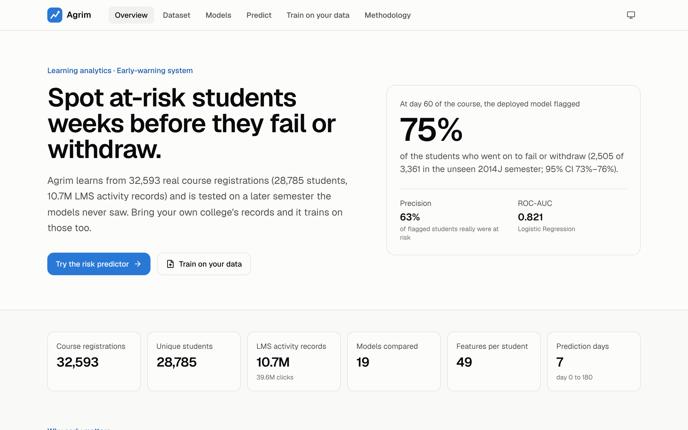
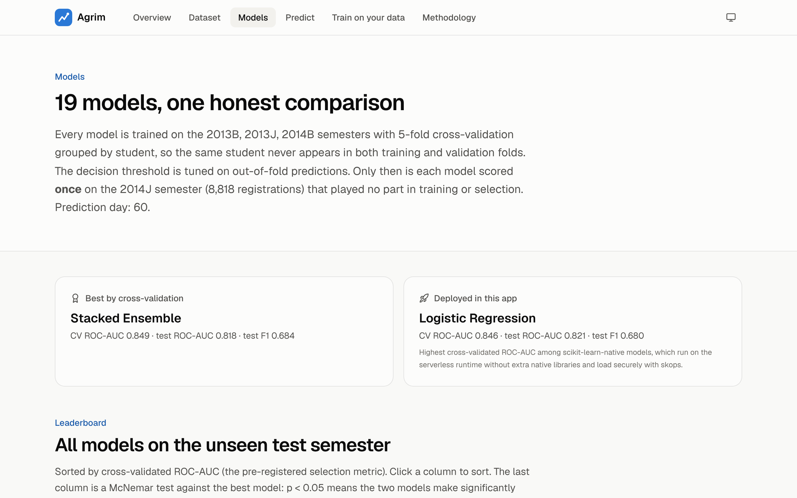
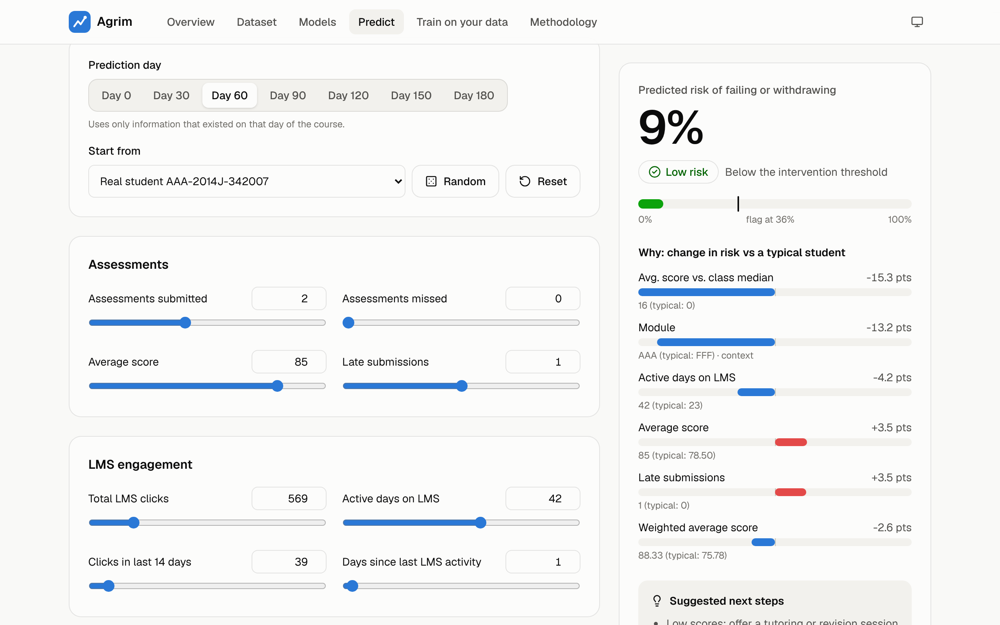
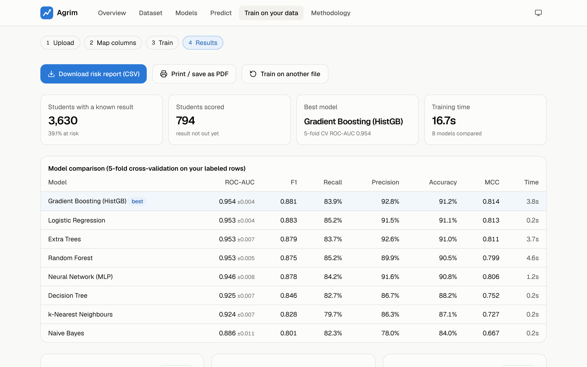
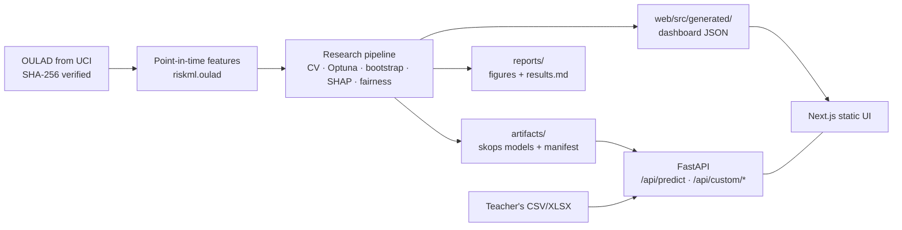

# Agrim — Early Academic-Risk Prediction

**Find students who are likely to fail or withdraw while there is still time to help.**

Production Live site :- https://academic-risk-prediction-theta.vercel.app/

Agrim is an end-to-end machine-learning system built on the public **Open University Learning
Analytics Dataset (OULAD)** — 32,593 course registrations, 28,785 students and 10.6 million
virtual-learning-environment (VLE) interactions. It contains:

1. **A reproducible research study**: 19 models (from logistic regression to tuned
   gradient boosting, CatBoost and a stacked ensemble) are compared with student-grouped
   cross-validation and tested on a later semester. The study also covers confidence intervals,
   significance tests, an early-warning timeline, ablation, explainability and a fairness audit.
2. **A live web app**: a research dashboard and an explainable single-student risk predictor
   with what-if analysis.
3. **Bring-your-own-data training**: a teacher uploads a CSV/Excel sheet of their own students.
   Models are trained and compared on it in seconds, and current students get a risk score with
   reasons. Nothing is stored.

Every number shown in the app is produced by the pipeline from the real data. Nothing is typed
in by hand.

<!-- RESULTS:START -->

### Headline results (day 60, unseen 2014J semester)

- **19 models compared**; best by cross-validation: **Stacked Ensemble** (test ROC-AUC 0.818).

- **Deployed: Logistic Regression**: ROC-AUC 0.821 [0.812–0.830], F1 0.680, recall 74.5% — it flags 2,505 of the 3,361 students who went on to fail or withdraw.

- Early warning (deployed model, test ROC-AUC by prediction day): day 0: 0.722, day 30: 0.744, day 60: 0.821, day 90: 0.845, day 120: 0.879, day 150: 0.904, day 180: 0.925.

| Model | CV ROC-AUC | Test ROC-AUC [95% CI] | Test F1 |
|---|---|---|---|
| Stacked Ensemble | 0.849 | 0.818 [0.809–0.827] | 0.684 |
| XGBoost (tuned) | 0.846 | 0.805 [0.796–0.815] | 0.681 |
| LightGBM (tuned) | 0.846 | 0.804 [0.794–0.813] | 0.678 |
| Logistic Regression | 0.846 | 0.821 [0.812–0.830] | 0.680 |
| CatBoost | 0.845 | 0.813 [0.804–0.822] | 0.676 |

_Auto-generated by the pipeline on 2026-11-16; full tables in [reports/results.md](reports/results.md)._

<!-- RESULTS:END -->

## Screenshots

| Overview | Models |
|---|---|
|  |  |
| **Live predictor** | **Train on your data** |
|  |  |

## Architecture



| Layer | Technology |
|---|---|
| Data & ML | Python, pandas, NumPy, scikit-learn, LightGBM, XGBoost, CatBoost, Optuna, matplotlib |
| Serving | FastAPI, Pydantic v2, skops (secure model format), uvicorn |
| Web | Next.js (App Router, static export), React, TypeScript, Tailwind CSS v4, Recharts |
| Quality | pytest (+ coverage), Ruff, ESLint, Vitest, Playwright (desktop + mobile), GitHub Actions, Dependabot, pip-audit |
| Hosting | Vercel (main) · Docker on Hugging Face Spaces (backup) · GitHub Codespaces |

## Quick start

Want to see it without installing anything? Open the repository in **GitHub Codespaces**
(**Code → Codespaces → Create codespace**). The site starts automatically on port 8000.

Locally, with Python 3.12+ and Node 22+:

```bash
python -m venv .venv && source .venv/bin/activate
```

```bash
pip install -r requirements-dev.txt
```

```bash
cd web && npm ci && npm run build && cd ..
```

```bash
SERVE_STATIC=1 uvicorn riskml.server.main:app --port 8000
```

Then open <http://localhost:8000>. API reference: <http://localhost:8000/api/docs>.

Deployment to Vercel and Hugging Face is described step by step in
[docs/DEPLOYMENT.md](docs/DEPLOYMENT.md).

## Reproduce the research

```bash
pip install -r requirements-research.txt
```

```bash
make research    # downloads OULAD (47 MB), verifies SHA-256, runs the full study (~35 min on 4 cores)
```

The study rewrites `artifacts/` (served models), `web/src/generated/` (dashboard data) and
`reports/` (figures + `results.md`). There is also a Colab notebook in
[notebooks/colab_research.ipynb](notebooks/colab_research.ipynb), and a GitHub Actions workflow,
**Retrain models**.

## Tests

```bash
make test                         # Python: unit, API, security, concurrency, pipeline
```

```bash
cd web && npm run lint && npm run typecheck && npm test && npm run e2e
```

## Project structure

```
riskml/
  oulad/        download (checksum), cleaning, point-in-time feature engineering
  modeling/     model zoo, metrics (bootstrap CI, McNemar, curves), fairness
  research/     pipeline, Optuna tuning, SHAP, figures, Markdown report
  serving/      integrity-checked model registry, explainable predictor
  custom/       upload parsing, column profiling, bring-your-own-data trainer
  server/       FastAPI app, security middleware, request/response schemas
api/index.py    Vercel serverless entry point
artifacts/      deployed models (skops), feature schemas, sample students, manifest
web/            Next.js app (dashboard, predictor, training wizard) + Playwright tests
tests/          pytest suite
docs/           methodology, model card, deployment, security, viva guide, demo script
reports/        generated figures and results tables for the project report
sample_data/    UCI dropout dataset (sample upload) and a blank college template
```

## Documentation

- [Methodology](docs/METHODOLOGY.md): problem formulation, leakage prevention, validation protocol
- [Model card](docs/MODEL_CARD.md): intended use, performance, limitations, ethics
- [Results](reports/results.md): every table, generated by the pipeline
- [Deployment](docs/DEPLOYMENT.md) · [Security](docs/SECURITY.md) · [Demo script](docs/DEMO_SCRIPT.md) · [Viva guide](docs/VIVA_GUIDE.md)

## Data sources and licences

- Kuzilek, J., Hlosta, M. & Zdrahal, Z. (2017). *Open University Learning Analytics dataset.*
  Scientific Data 4, 170171. doi:10.1038/sdata.2017.171 — CC BY 4.0.
- Realinho, V., Vieira Martins, M., Machado, J. & Baptista, L. (2021). *Predict Students' Dropout
  and Academic Success.* UCI Machine Learning Repository. doi:10.24432/C5MC89 — CC BY 4.0.
